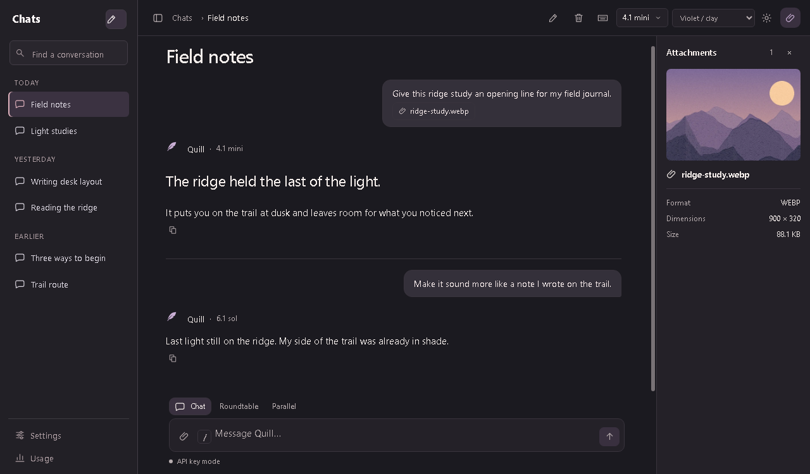

# Quill

Quill is an independent desktop client for the replacement of the OpenAi desktop app. It uses a local React interface, a Rust backend and the system WebView on Windows, macOS and Linux. Each installation keeps its own chat history.

The ram usage difference is significant, Quill itself runs under 4mb of ram (counting the external webview manager it is roughly 50mb). On the other hand Chatgpts desktop app runs over 2gb.

The Afterglow desktop workspace has chat history on the left and an attachments panel on the right. Select the paperclip in the toolbar to open it. Settings → Workspace controls reading width, compact spacing, attachment visibility and the send shortcut. A reply shows its own short model label. Hover the label for the full model ID. Older chats use their recorded request model when no response model was saved.

Search your conversation titles in the sidebar or open **Usage** for your local activity. Switch the reply model in the top bar. The keyboard guide shows your configured shortcut, and the composer’s **/** button opens slash commands.

Choose **Settings → Motion** to follow your system preference or select smooth or reduced motion. **Delete** expands a confirmation beneath the conversation toolbar. Press **Escape** to keep the chat. In Settings, choose an **Interface font** and save your preferences.

## Download for Windows

[Download Quill 0.2.9 for Windows x64](https://github.com/wyattbombara/Quill/releases/download/v0.2.9/Quill-0.2.9-windows-x64.zip). Extract the ZIP and open **Quill/quill-chat.exe** with both included DLLs beside it. To send messages, connect an eligible ChatGPT account or supply your own OpenAI API key.



## Workspace settings

Choose whether Quill reopens your last chat, saves unsent drafts with attachments, and quits or hides in the tray when closed. Set independent reply and code sizes, pause automatic scrolling, and show usage for this chat or today beside the composer. Daily totals start with requests recorded by version 0.2.8 and use the device's local calendar day. Background completion notifications are optional. Click one to open its chat. Message previews are off by default.

## Connect to OpenAI

Open **Settings → Continue with ChatGPT** to sign in through your browser. Authorize Quill to use your eligible ChatGPT plan, return to the app, and choose a model from your account’s catalog. No API key is required in this mode. Plan eligibility, model availability and usage limits are determined by OpenAI. Use **Manage usage** in Quill to open ChatGPT usage settings. [OpenAI’s guide for open-source apps](https://developers.openai.com/siwc/token-sharing-open-source)

After connecting, choose **Start chatting** to return to your conversation. To renew the selected account’s authorization manually, open **Connection options → Reconnect this account**.

To use API billing, save your own OpenAI API key in Settings. If a ChatGPT account is selected, choose **Use API key billing** explicitly. An expired session, denied consent or plan limit stops the request. Quill keeps an API key and a ChatGPT session separate, and sign-in does not import chatgpt.com conversations.

Quill validates browser sign-in with PKCE, state, a nonce and OpenAI’s signed identity token. Rust stores each registration’s tokens encrypted in local SQLite with a wrapping key in the system keychain. On sign-out, Quill attempts to revoke the renewable session and clears the local token set.

## Appearance

The toolbar offers five palettes. Violet / clay uses the glass styling from the UI preview in light and dark modes. Use the sun or moon to switch appearance, or select System in Settings to follow the OS. Settings also lets you show the centered feather and Quill name in the sidebar. On Windows the taskbar identifies the app as Quill using its feather icon. The draggable title bar follows the palette and shows only the window controls.

## Parallel agents

Select **Parallel** beside the composer or type `/parallel your message`. Choose at least two agents. Quill caps Free, unknown tiers, and API-key mode at three seats. Plus, Go, Team, Business, Enterprise and Edu get four. Pro gets five below 20 requests recorded for that account on this device in the preceding hour, then four until activity falls below the threshold. Provider eligibility and limits still apply. Reconnect an older registration in Settings to refresh its signed plan details. Give each an optional assignment, then select **Run agents**. Each agent gets the same snapshot of the chat history, goal, prompt and attachments, alongside its own personality and assignment. Each streams one labeled reply. A failed agent does not interrupt its peers. Completed answers are available together in the next turn. Parallel stays selected for follow-ups in the current chat. Select **Parallel** again to return to single replies. Each turn uses one model request per participating agent.

## Roundtable

Choose **Roundtable** beside the composer, or enter `/debate your question`. Select a seat to edit its name, model, and personality. Choose a personality preset or write your own. Use **Add agent** or **Remove agent** to seat two to eight people. Multiple seats can use the same model. The last seat chairs the debate. Review the displayed billing source and request range, then choose **Start debate**. Settings → Agents sets a hard limit of two to eight requests, default eight. With eight seats and eight requests, seven agents open and the chair synthesizes the eighth response. Save and switch named teams per account. Architect, Tester and Teacher join the five original personality presets. The last started roster is remembered for each billing account on this device. Each saved debate keeps the profiles it used. The same conversation context and attachments go to the participants. ChatGPT sign-in uses the account catalog; API-key billing uses the key’s model list.

Finch, Moss and Pip publish independent openings. The last seat reviews them, returns an answer on consensus, or invites as many rebuttals as the remaining budget allows before synthesizing a conclusion. The circle highlights active speakers. Scroll the public transcript to read earlier contributions. Stop cancels the run. The transcript, model assignments and status are retained locally. Usage counts each participant request.

## Slash commands

Type `/` at the start of a chat message to browse local commands. Use the arrow keys to select one, Tab to complete a name, or Enter to choose it. For commands with an argument, enter the value and press Enter again. Escape dismisses the list. Use `//` to send a message beginning with a literal slash.

| Command | Action |
| --- | --- |
| `/new` | Start a conversation with any currently attached files. |
| `/rename <title>` | Rename the current conversation. |
| `/model <id>` | Save the model ID for future replies. |
| `/theme light`, `/theme dark`, `/theme system` | Save the appearance preference. |
| `/settings` | Open Settings. |
| `/help` | Show the command list. |
| `/goal <text>`, `/goal`, `/goal clear` | Set, view, or clear the current conversation’s goal. The next message you send includes the active goal as user context. |
| `/status` | Show requests and reported input/output tokens for this chat and this installation. |

Quill keeps device totals when you delete a chat. On upgrade, it counts requests from existing conversation history. Historical token counts and counts for requests that end without a usage report are unavailable. The report covers activity recorded by this installation and can be opened offline.

## Source tree

```text
Quill/
├── index.html
├── package.json, package-lock.json
├── tsconfig.json, vite.config.ts
├── public/licenses/                Instrument font licenses
├── src/
│   ├── main.tsx, App.tsx           Entry point, sidebar and chat lifecycle
│   ├── ipc.ts                     Typed commands, arguments, results and stream channel
│   ├── files.ts, style.css
│   └── components/
│       ├── Composer.tsx, Transcript.tsx
│       └── MarkdownBody.tsx, Settings.tsx
└── src-tauri/
    ├── Cargo.toml, Cargo.lock, build.rs
    ├── tauri.conf.json, tauri.linux.conf.json, updater.example.json
    ├── capabilities/main.json, permissions/desktop.toml
    ├── icons/
    ├── src/
    │   ├── main.rs, app.rs, lib.rs
    │   ├── model.rs, error.rs
    │   ├── commands/
    │   │   └── mod.rs, auth.rs, chat.rs, settings.rs
    │   └── services/
    │       ├── mod.rs, api.rs, database.rs, schema.sql
    │       └── accounts.rs, oauth.rs, credentials.rs, desktop.rs, updates.rs
    └── tests/
        └── history.rs, oauth.rs, transport.rs
```

## Build and run

For database encryption, builds use bundled SQLCipher. On Windows install matching OpenSSL headers and libraries, set **OPENSSL_DIR** (or **OPENSSL_INCLUDE_DIR** and **OPENSSL_LIB_DIR**), and distribute the matching crypto runtime if linking dynamically. Linux uses libssl-dev and macOS uses CommonCrypto.

Use Rust **1.90 or newer** and Node **22.12 or newer** with npm. Run commands from the directory containing `package.json`. Both lockfiles are included. Build each platform’s installer on that operating system. [Tauri prerequisites](https://v2.tauri.app/start/prerequisites/)

| Platform | Install before building | Release command |
| --- | --- | --- |
| Windows 10/11 | Visual Studio Build Tools with **Desktop development with C++**, the Windows SDK, the MSVC Rust toolchain and WebView2 Evergreen Runtime | `npm run tauri build -- --bundles nsis` |
| macOS 13+ | Xcode Command Line Tools (`xcode-select --install`) and Rust for your Mac’s architecture. The app uses WKWebView. | `npm run tauri build -- --bundles app,dmg` |
| Linux | The GTK, WebKitGTK 4.1, app indicator, D-Bus and build packages below. For saved keys, run a Secret Service provider such as GNOME Keyring in your desktop session. | `npm run tauri build -- --bundles deb` |

On Ubuntu 24.04 or Debian 12, install the native build dependencies first.

```sh
sudo apt update
sudo apt install build-essential pkg-config curl wget file libwebkit2gtk-4.1-dev \
  libgtk-3-dev libayatana-appindicator3-dev librsvg2-dev libssl-dev libdbus-1-dev \
  libxdo-dev patchelf
```

Install frontend packages and launch the development build.

```sh
npm ci
npm run tauri dev
```

To check the project or produce the release packages, stop the development app using **Quit Quill** in the tray, then run the checks and the release command for your platform.

```sh
npm run build
cargo test --locked --manifest-path src-tauri/Cargo.toml
npm run tauri build -- --no-bundle
```

The last command builds an executable for the current platform. Installers from the platform-specific commands appear under `src-tauri/target/release/bundle/` unless you set `CARGO_TARGET_DIR`. Windows GNU builds require the accompanying `WebView2Loader.dll` beside a standalone executable. The Windows installer can fetch the system WebView2 runtime when required. The Linux configuration targets DEB so WebKitGTK stays a system dependency. Linux needs a compatible system WebKitGTK, with tray support and global shortcut availability depending on the desktop session. The shortcut plugin uses X11 on Linux. A shortcut registration conflict appears in Settings and leaves the app usable. [Global shortcut plugin](https://v2.tauri.app/plugin/global-shortcut/)

## Using the app

- Enter sends a message. Shift+Enter inserts a newline. During generation, **Stop** cancels the HTTP operation and keeps the text received so far. After an abrupt exit, reopening a chat shows its latest saved checkpoint as interrupted.
- Use **New chat**, the history sidebar, **Rename** and **Delete** to manage conversations. The tray offers Open, New chat and Quit. Closing the window hides it. The default global shortcut is **Ctrl+Alt+Space**, including on macOS.
- Drop files on the composer or use **Attach**. Quill supports PNG, JPEG, WebP, PDF, TXT, Markdown, CSV and JSON. Limits are six files per turn, 8 MiB per file and 16 MiB total per turn. File contents are uploaded inline when you send. Completed turns replay their attachments on subsequent requests. A 48 MiB encoded attachment-history limit bounds a single request.
- In API key mode, Settings offers 14 model presets grouped by GPT-6, GPT-5 and GPT-4. Select **Custom model…** to enter another Responses-compatible model ID, then choose **Save preferences**. **Save key** and **Remove key** use Windows Credential Manager, macOS Keychain or Linux Secret Service. The frontend receives only the key’s presence when reopening Settings. **System** appearance follows OS changes.
- Quill encrypts the entire chat database with SQLCipher, including titles, prompts, replies, attachments, goals, and agent transcripts. A randomly generated 256-bit history key lives in your OS credential store. Back up that credential with the database. Losing it makes encrypted history unreadable. An unlocked account or running Quill can still read the conversations.
- On the first launch after upgrading from 0.2.8, Quill checkpoints the old SQLite database, verifies an encrypted copy, and replaces the original. You need enough free space for that copy. SQLite recovers rollback journals and checkpoints its WAL before migration. Quill checks that the old -wal, -shm, and -journal files are gone before replacing the database. Busy or unresolved sidecars stop the upgrade. Unlinking files cannot erase plaintext remnants from disk, older backups, or filesystem snapshots. Deleting a chat removes its history and attachments from Quill. Secure deletion is enabled within SQLite, but deletion cannot guarantee erasure from storage media or backups.
- Unsent text and attachments stay in memory by default. Enabling **Restore unsent text and attachments** saves those drafts in the WebView's local IndexedDB, outside SQLCipher encryption. Turning the setting off and saving clears the stored drafts. Drafts retained in the current window can still be edited or sent.

## Streaming contract

The endpoint is wired in `src-tauri/src/services/api.rs`. Rust sends a bearer-authenticated `POST /v1/responses` with the selected model, conversation input, `stream: true` and `store: false`. The SSE parser handles network chunk boundaries independently of UTF-8 characters and SSE frames. Text and refusal deltas travel over an ordered Tauri channel. The UI renders each delta as received. A delta can contain several tokens. Failed, incomplete and prematurely closed streams keep their partial text and error status. Only completed conversation pairs enter the next request. [OpenAI streaming guide](https://developers.openai.com/api/docs/guides/streaming-responses) · [Responses stream events](https://developers.openai.com/api/reference/resources/responses/streaming-events)

For a new model or API revision, verify the model’s Responses support, accepted input modalities, file formats, event fields and terminal events in the official OpenAI documentation. Images use `input_image.image_url` data URLs. Documents use `input_file.filename` and `file_data`. No separate Files API upload or remote file ID is needed. Rate-limit and model-access failures appear with the affected reply. [File inputs](https://developers.openai.com/api/docs/guides/file-inputs) · [Image inputs](https://developers.openai.com/api/docs/guides/images-vision)

## Signed updates

The application checks for updates on startup. An available release marks Settings, where **Check for updates** and **Install and restart** use Tauri’s updater. The development configuration has an empty feed and public key. To publish releases:

1. Run `npm run tauri signer generate -- -w /secure/path/quill.key` using a path outside this project. Back up the private key.
2. Copy `src-tauri/updater.example.json` to `src-tauri/updater.release.json`. Replace the example URL with your HTTPS release manifest and the public key placeholder with the contents of the generated public-key file.
3. Set `TAURI_SIGNING_PRIVATE_KEY` in the release environment to your private key or its file path. Supply `TAURI_SIGNING_PRIVATE_KEY_PASSWORD` if the key is encrypted. Increase the app version for the next release. Build both the original installed release and subsequent releases with the real overlay, for example `npm run tauri build -- --config src-tauri/updater.release.json --bundles nsis`.
4. Publish the updater artifacts and signatures. The static manifest needs the version and matching platform entries with a download URL and signature contents for each architecture. For the Linux DEB build, publish the signed DEB with a matching platform key such as `linux-x86_64-deb`. Installing the update can prompt for system package permissions. macOS and Windows distribution signing are separate release steps. [Tauri updater guide and manifest examples](https://v2.tauri.app/plugin/updater/)

## Boundaries

Privileged operations live in Rust. The main window’s capability allows the named chat commands, event subscription and native confirmation dialogs. The local UI has no general filesystem, shell or HTTP permission. Chat links open in the system browser after a Rust-side HTTP(S) scheme check. Markdown raw HTML is disabled and remote images in replies render as alt text.


